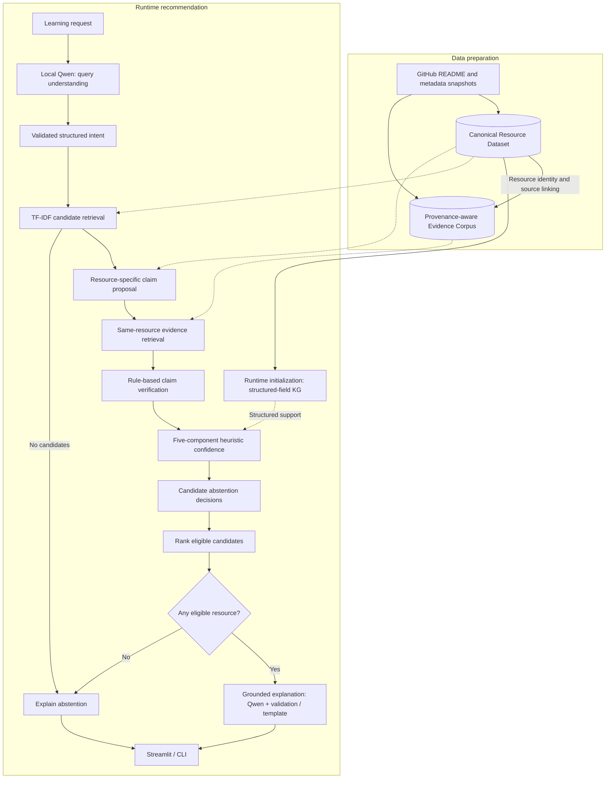

# VeriTrust-Rec

**Evidence-Aware Uncertainty for Trustworthy LLM-based AI Learning Resource Recommendation**

[简体中文](README.zh-CN.md) · [Documentation](docs/README.md) · [Data setup](docs/DATA_SETUP.md) · [Evaluation](docs/evaluation/S4_LITE_REPORT.md)

VeriTrust-Rec investigates how external evidence can inform the reliability of LLM-assisted recommendations for AI/ML learning resources and open-source projects. It represents factual recommendation statements as resource-specific claims, retrieves their supporting material, verifies the relationship between claim and evidence, and uses those results in confidence estimation, ranking, and selective recommendation.

The implemented **Summer Edition** provides an executable prototype of this research direction: a provenance-aware data pipeline, TF-IDF retrieval, a structured knowledge graph, claim-level verification, heuristic confidence, abstention, and grounded explanations through a bilingual Streamlit application. Local Qwen handles natural-language intent and explanation; the backend controls factual records and recommendation decisions.

**Evidence → Verification → Uncertainty → Decision**

[Motivation](#research-motivation) · [Architecture](#system-architecture) · [Evaluation](#evaluation) · [Research directions](#research-status-and-next-steps) · [Quick start](#quick-start)

## Research motivation

### Learning-resource recommendation involves several kinds of reasoning

A learner may ask:

> I know Python and basic machine learning. I want to study Transformers with PyTorch and would prefer resources with implementation examples.

Answering this request requires understanding the learner's goal, finding relevant resources, checking their actual properties, and explaining why they fit. An LLM is useful for interpreting such a request, but the factual basis of a recommendation needs its own representation. A resource may mention PyTorch while using a different implementation framework; a repository about Transformers may offer a general-purpose tool rather than a learning tutorial. Maintenance status also depends on metadata and time.

VeriTrust-Rec makes these distinctions explicit. **Relevance** concerns a resource's match to the request. **Verification** concerns whether available evidence supports a particular statement about it. **Confidence** summarizes the signals used to make a recommendation decision. Keeping these quantities separate makes the process inspectable and allows its components to be evaluated individually.

### Evidence must support the particular claim being made

A recommendation such as “this resource covers Transformers, uses PyTorch, and is actively maintained” contains several independently checkable claims. Each needs appropriate evidence from that resource: topical material, an explicit framework statement, or repository status and timestamps. A citation to a broadly related page does not resolve all three questions.

The prototype therefore retrieves evidence **after proposing a resource-specific claim** and restricts that retrieval to the same resource. It retains the source URL, document and chunk identities, and provenance needed to inspect the result. When the available material is insufficient, the claim remains `UNKNOWN`; explicit contradiction is represented separately.

### Evidence support motivates a further uncertainty question

Finding a supporting passage leaves additional questions about coverage, source provenance, consistency, and temporal validity. A recommendation supported across its important attributes should be distinguishable from one supported only in part. The long-term research question is:

> **Can recommendation uncertainty be grounded in the quality, consistency, and provenance of external evidence, and can that uncertainty guide reliable selective recommendation?**

This motivates three connected lines of inquiry:

| Research question | What needs to be examined |
|---|---|
| **Claim grounding** | How do resource-specific evidence and structured knowledge affect unsupported recommendation claims? |
| **Evidence-aware uncertainty** | Which evidence signals predict recommendation failures, and how can their estimates be calibrated against observed correctness? |
| **Selective recommendation** | How does abstaining under insufficient or contradictory evidence change the trade-off between coverage and error? |

The Summer Edition implements a transparent baseline for investigating these questions. Its current confidence model is an interpretable heuristic; learned uncertainty, calibration, and systematic risk–coverage analysis form the next research stage.

## System architecture

The system has two connected workflows. **Data preparation** turns saved GitHub snapshots into canonical Resources and a linked Evidence Corpus. **Runtime recommendation** consumes those validated artifacts to assess candidates before generating an explanation. Runtime initialization builds the knowledge graph from canonical structured fields; the graph supplies a structured support signal during assessment.



### 1. A shared identity and provenance foundation

The data layer separates a resource's structured description from the material used to verify statements about it:

| Artifact | Contents | Role in recommendation |
|---|---|---|
| **Resource Dataset** | Canonical IDs, names, URLs, topics, framework fields, repository status, and field-level provenance | Candidate search and structured resource properties |
| **Evidence Corpus** | README and repository-metadata documents, retrievable chunks, source URLs, timestamps, and content hashes | Claim-specific retrieval and traceable verification |
| **Simple knowledge graph** | Relations derived from canonical structured Resource fields, with provenance references | Structured support for applicable topic and framework claims |

GitHub Resources use numeric repository identities (`github:<id>`), so names can change without redefining the resource. Evidence documents, chunks, and build identities are deterministic for matching inputs, configuration, and implementation versions. This makes it possible to follow a displayed statement back through its claim and evidence to the saved source material.

Text and graph views serve complementary operations: text preserves the material that can be quoted and checked; the graph organizes normalized relations. Both may originate from the same repository, so graph–text agreement must be interpreted with their shared provenance in view.

### 2. Two stages of retrieval

**Candidate retrieval** searches the Resource Dataset using TF-IDF and cosine similarity over the validated intent. This stage identifies resources worth assessing. **Claim-specific evidence retrieval** then searches chunks belonging to each candidate, using the claim's object and relation to find relevant material. Metadata evidence receives priority where it is appropriate, such as maintenance and license checks.

This separation gives resource matching and factual support distinct responsibilities. A resource can enter the candidate set because it is relevant while some of its proposed attributes remain unsupported. Same-resource binding also prevents a statement about one project from being justified by a passage about another.

### 3. Explicit claims and three-way verification

The current backend proposes four claim types:

| Claim type | Question assessed |
|---|---|
| `uses_framework` | Does the resource use the requested framework? |
| `covers_topic` | Does it cover the requested topic? |
| `is_maintained` | Do repository status and timestamps satisfy the configured maintenance rule? |
| `has_license` | Does the metadata identify an explicit license recognized by the configured rule? |

Rule-based verification assigns `SUPPORTED`, `UNKNOWN`, or `CONTRADICTED` and retains the Evidence references used in that assessment. `UNKNOWN` captures insufficient support; it can coexist with supported claims on the same resource. Attributes such as beginner suitability or instructional quality require additional evidence and assessment beyond these four claim types.

### 4. Evidence-aware confidence and selective decisions

The Summer Edition combines five observable signals. With the default configuration:

$$
C(r)=0.20R(r)+0.30E(r)+0.35V(r)+0.10K(r)+0.05S(r)
$$

| Signal | Current definition |
|---|---|
| **R — Retrieval relevance** | The candidate's TF-IDF cosine similarity |
| **E — Evidence coverage** | Fraction of proposed claims with at least one retrieved Evidence chunk |
| **V — Verification support** | Fraction of all proposed claims labeled `SUPPORTED` |
| **K — KG support** | Fraction of applicable topic/framework claims supported by structured graph relations; neutral value 0.5 when none apply |
| **S — Source prior** | Mean source-reliability prior across distinct Evidence sources referenced by verification |

Coverage measures whether evidence was retrieved; verification measures what that evidence supports. Source aggregation counts distinct Evidence sources rather than repeatedly rewarding chunks from the same document. **The resulting Confidence is a heuristic score, not a calibrated probability of correctness.**

The default policy abstains on a candidate when it has a contradicted claim, no evidence coverage, confidence below 0.50, or a critical local processing error. Eligible candidates are ranked by:

$$
\operatorname{Score}(r)=0.60R(r)+0.40C(r)
$$

The system reports global abstention when retrieval yields no candidate or every candidate is rejected. Query-processing failures have their own error states, preserving the distinction between an execution failure and a recommendation decision.

### 5. Explanation follows the decision

Qwen has two language-facing tasks: interpreting the initial request and writing a summary and reasons from the final structured result. Resource order, verification labels, scores, factual text, and Claim/Evidence references are controlled by the backend. The explanation layer uses bounded inputs, validates grounding, and falls back to deterministic templates when model output is unavailable or fails validation.

The UI exposes the recommendation alongside its claims, evidence, confidence breakdown, and pipeline trace. This connects the final presentation to the intermediate records needed for error analysis. Prepared data can also be used through the structured-intent core API without invoking an LLM.

## Web interface


*The Chinese query page before submission, using local Ollama/`qwen3:8b`. The application also provides Recommendations, Evidence & Verification, and Pipeline Trace tabs.*

## Evaluation

### Historical S4-Lite evaluation

S4-Lite evaluates the accepted Summer Edition on a frozen corpus of **200 Resources, 400 Evidence Documents, and 5,902 Chunks**. Human-confirmed benchmark `v1.0.0` contains 10 retrieval cases, 15 blind-annotated verification cases, and three abstention functional checks.

| Metric | Result | Evaluation size |
|---|---:|---:|
| Retrieval Top-1 Reasonable Rate | 60% (6/10) | 10 cases |
| Retrieval Top-3 Hit Rate | 80% (8/10) | 10 cases |
| Retrieval MRR@10 | 0.745 | 10 cases |
| Verification Accuracy | 86.67% (13/15) | 15 cases |
| Verification Macro-F1 | 0.8917 | 15 cases |
| Abstention functional checks | 3/3 | 3 cases |

The error analysis identifies two useful directions. Lexical retrieval sometimes ranks a broad framework or tool above a more suitable educational resource. The verifier's two errors classify explicitly supported claims as `UNKNOWN`, exposing gaps in rule coverage. The abstention checks cover a normal request, an out-of-domain cooking request, and a controlled archived-resource contradiction case; their 3/3 result describes those functional cases.

Runtime was measured with Ollama `0.34.0` / `qwen3:8b` on an Intel Core i7-14650HX and RTX 4060 Laptop GPU: one cold run took **17.87 s**, and five warm runs averaged **9.54 s** end to end. All six measured runs preserved the backend's resource order and canonical references. These measurements and the small benchmark provide preliminary course-project evidence. The [full S4-Lite report](docs/evaluation/S4_LITE_REPORT.md) contains the protocol, hardware, frozen identities, failures, and execution limitations; earlier milestones are documented in [S2](docs/evaluation/S2_QUERY_UNDERSTANDING_BENCHMARK.md), [S3](docs/evaluation/S3_FINAL_GENERATION_BENCHMARK.md), and [S3.5](docs/evaluation/S3_5_RESOURCE_EXPANSION_REPORT.md).

### Independent snapshot validation and reproduction

A separately collected local run produced **20 Resources, 40 Documents, and 644 Chunks**. Real-Qwen and Streamlit checks exercised recommendations with same-resource Evidence references, grounded explanation, and out-of-domain abstention. The independent snapshot passed **177 offline tests before its initial commit**. These engineering checks use a different data run from the historical S4-Lite evaluation.

The standalone snapshot omits the frozen 200-resource corpus and quoted Verification Gold. Exact historical reproduction requires the matching, separately authorized inputs and the original experiment's code and version identity. Live GitHub collection creates a new dataset and build identity. The [data setup guide](docs/DATA_SETUP.md) explains the available local build and optional frozen-copy workflows.

## Research status and next steps

The current implementation establishes an end-to-end, inspectable baseline. Its scope is shaped by lexical retrieval, a GitHub-only corpus with discovery and popularity bias, conservative rule verification, and small human-reviewed benchmarks. Many semantic Resource fields remain unknown. Human-language preferences can be parsed, while resource-language filtering is still incomplete. Grounding validation checks identities and backend facts; model-generated prose can still contain errors.

The next research stage will examine the central questions through controlled comparisons:

| Direction | Planned investigation |
|---|---|
| **Retrieval and evidence** | Semantic/hybrid baselines, broader learning-resource sources, and the complementary value of text and structured knowledge |
| **Verification** | Stronger entailment-based verification and conflict-aware evidence fusion on larger, independently annotated cases |
| **Uncertainty** | Compare evidence-aware estimates with model-only confidence; assess calibration using ECE, Brier score, and reliability diagrams |
| **Selective recommendation** | Measure risk–coverage behavior under insufficient, conflicting, stale, and weak-source evidence |

These are research objectives for extending the Summer Edition; the evaluation above measures the implemented baseline.

## Quick start

### 1. Install dependencies and run offline tests

Use Anaconda or Miniconda with Python 3.11:

```powershell
conda env create -f environment.yml
conda activate veritrust-rec
python -m pytest -q
```

The offline suite uses fixtures and mocks and runs without generated data or Ollama. Python dependencies are listed in `requirements.txt`; environment details are in the [development guide](docs/DEVELOPMENT.md).

### 2. Prepare local data

A fresh clone has no ready-to-use Resource Dataset or Evidence Corpus. Follow the [data setup guide](docs/DATA_SETUP.md): collect the `baseline_20` GitHub profile, pin the returned raw run, build and review Phase 2 Resources, then build and validate Phase 3 Evidence. Collection requires network access; the builders run offline. A local `GITHUB_TOKEN` helps with rate limits.

Prepared data also supports the [StructuredIntent-to-core API](docs/DEVELOPMENT.md#run-the-core-without-an-llm) without Ollama.

### 3. Run natural-language recommendations

Install [Ollama](https://ollama.com/), start its local service, and obtain the configured model:

```powershell
ollama pull qwen3:8b
python -m recommender "I want to learn Computer Vision with PyTorch." --json --no-log
python -m recommender "I want to learn Computer Vision with PyTorch." --final --language en --no-log
```

The first command runs query understanding and the recommendation core. `--final` adds the post-decision explanation. The model transport uses local loopback endpoints.

### 4. Open the web app

```powershell
python -m streamlit run streamlit_app.py
```

Open Streamlit's local address, usually `http://localhost:8501`. Runtime settings and default scoring weights are in [configs/summer.yaml](configs/summer.yaml). CLI `--no-log` disables session audit writes; the UI enables session logging by default and leaves raw-query persistence off by default.

## Repository and documentation

```text
data_pipeline/       GitHub collection and Resource/Evidence builds
recommender/         Query parsing, retrieval, KG, claims, verification, decisions
evaluation/          Evaluator and benchmark availability information
tests/               Offline unit, integration, and regression tests
configs/             Data/runtime configuration and prompts
streamlit_app.py     Web application entry point
app/                 UI components and localization
docs/                User guides and historical evaluation reports
```

Start with the [documentation index](docs/README.md), [data setup](docs/DATA_SETUP.md), and [development guide](docs/DEVELOPMENT.md). Contributions from **wwwrh** and **hanw479** are recorded in [AUTHORS.md](AUTHORS.md).

This snapshot has no project-wide `LICENSE`. Third-party resource and Evidence content remains subject to its applicable terms.
