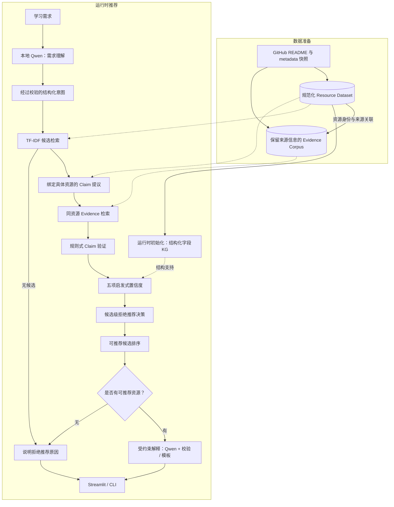
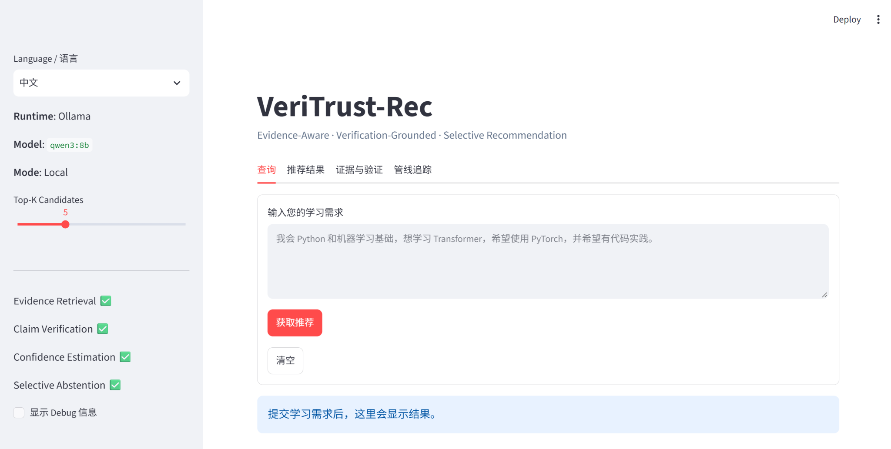

# VeriTrust-Rec

**基于证据感知不确定性的可信 AI 学习资源推荐系统**<br>
*Evidence-Aware Uncertainty for Trustworthy LLM-based AI Learning Resource Recommendation*

[English](README.md) · [文档索引](docs/README.md) · [数据准备](docs/DATA_SETUP.md) · [评测报告](docs/evaluation/S4_LITE_REPORT.md)

VeriTrust-Rec 面向 AI/ML 学习资源与开源项目推荐，研究如何将外部证据纳入大语言模型辅助推荐的可靠性判断。系统把推荐中的事实性说法表示为绑定具体资源的 Claim，检索相关原始材料，验证证据与 Claim 的关系，再将验证结果用于置信度估计、排序与选择性推荐。

已实现的 **Summer Edition（暑校版）**为这一研究方向提供了可运行原型：涵盖保留来源信息的数据管线、TF-IDF 检索、结构化知识图谱、Claim 级验证、启发式置信度、拒绝推荐，以及中英双语 Streamlit 应用中的受证据约束解释。本地 Qwen 负责理解自然语言需求与组织解释，后端负责事实记录和推荐决策。

**Evidence → Verification → Uncertainty → Decision**

[研究动机](#研究动机) · [系统架构](#系统架构) · [评测](#评测) · [后续研究](#研究现状与后续方向) · [快速开始](#快速开始)

## 研究动机

### 学习资源推荐包含不同层次的判断

学习者可能提出这样的需求：

> 我掌握 Python 和机器学习基础，希望使用 PyTorch 学习 Transformer，最好有配套实现示例。

回答这一需求，需要理解学习目标、查找相关资源、核实资源属性，再解释其适配原因。LLM 能帮助理解此类复合请求，而推荐的事实依据需要被独立表示和检查：某个资源可能提到 PyTorch，实际实现却使用其他框架；一个与 Transformer 相关的仓库，也可能是通用工具而非教学教程。维护状态则需要结合仓库元数据与时间判断。

VeriTrust-Rec 将这些判断显式区分。**相关性（Relevance）**描述资源与需求的匹配程度；**验证（Verification）**判断现有证据是否支持某条具体说法；**置信度（Confidence）**汇总推荐决策所依据的信号。这样的划分使推荐过程可以被检查，也使不同模块能够分别接受评测。

### 证据需要对应具体的推荐说法

“这个资源覆盖 Transformer、使用 PyTorch，而且仍在积极维护”包含多条可以分别核查的 Claim。它们需要不同证据：主题内容、明确的框架使用说明，以及仓库状态和时间记录。一个大致相关的引用，不能同时回答这些问题。

因此，原型先提出绑定资源的 Claim，再围绕该 Claim 检索**同一资源**的证据，同时保留来源 URL、Document/Chunk 身份和来源信息。现有材料不足以作出判断时，Claim 保持 `UNKNOWN`；明确冲突则单独表示。用户由此能够看到推荐理由成立的具体依据，以及哪些属性仍缺少支持。

### 从证据支持进一步走向不确定性建模

找到支持性片段之后，还需要考虑证据是否覆盖关键属性、来源是否可靠、内容是否一致，以及时间是否有效。多个重要属性都有充分依据的推荐，应当与只有部分依据的推荐有所区别。项目的长期核心研究问题是：

> **能否将推荐不确定性与外部证据的质量、一致性及来源显式联系起来，并据此作出可靠的选择性推荐？**

这一问题形成三条相互衔接的研究线索：

| 研究问题 | 需要考察的内容 |
|---|---|
| **Claim 的证据支撑** | 绑定具体资源的证据与结构化知识，如何影响缺乏依据的推荐说法？ |
| **证据感知不确定性** | 哪些证据信号能够预测推荐失败，如何根据实际正确性校准这些估计？ |
| **选择性推荐** | 在证据不足或存在冲突时拒绝推荐，如何改变推荐覆盖率与错误风险之间的权衡？ |

暑校版为这些问题提供透明、可检查的实验基线。目前的 Confidence 采用可解释的启发式模型；学习式不确定性估计、校准和系统性的风险—覆盖率分析属于下一阶段研究。

## 系统架构

系统由两条相衔接的工作流组成。**数据准备链路**将保存的 GitHub 快照构建为规范化 Resources 及关联的 Evidence Corpus；**运行时推荐链路**读取经过验证的数据产物，在生成解释之前完成候选评估。运行时初始化根据规范化的结构化字段构建知识图谱，在候选评估时提供结构支持信号。



### 1. 共享的资源身份与来源基础

数据层分别保存资源的结构化描述，以及用于核查资源说法的原始材料：

| 数据产物 | 主要内容 | 在推荐中的作用 |
|---|---|---|
| **Resource Dataset** | 规范化 ID、名称、URL、主题、框架字段、仓库状态与字段级来源记录 | 候选检索与结构化资源属性 |
| **Evidence Corpus** | README 与仓库 metadata 文档、可检索片段、来源 URL、时间戳和内容哈希 | Claim 级检索与可追溯验证 |
| **简易知识图谱** | 从规范化 Resource 字段派生、附带来源引用的关系 | 为适用的主题与框架 Claim 提供结构支持 |

GitHub Resource 使用数值仓库身份 `github:<id>`，仓库改名不改变资源身份。在输入、配置与实现版本一致时，Evidence Document、Chunk 及构建身份具有确定性。展示给用户的说法由此能够沿 Claim、Evidence 回溯到保存的来源材料。

文本与图谱支持不同操作：文本保留可以引用和核查的内容，图谱组织规范化关系。两者可能来自同一仓库，因此解释文本与图谱的一致性时也需要考虑共享的来源。

### 2. 两阶段检索

**候选检索**根据经过校验的意图，对 Resource Dataset 执行 TF-IDF 与余弦相似度检索，确定值得进一步评估的资源。**Claim 级证据检索**随后围绕每条 Claim 的对象与关系，在所属资源的片段中寻找相关材料。维护与许可证等适合由 metadata 回答的问题，会优先考虑相应元数据证据。

这使资源匹配与事实支持分别承担明确职责：一个资源可以因相关而进入候选集，但其部分属性仍缺乏证据。同资源绑定也避免使用项目 A 的材料来支撑项目 B 的说法。

### 3. 显式 Claim 与三态验证

当前后端提出四类 Claim：

| Claim 类型 | 核查问题 |
|---|---|
| `uses_framework` | 资源是否使用请求中的框架？ |
| `covers_topic` | 资源是否覆盖请求中的主题？ |
| `is_maintained` | 仓库状态与时间记录是否满足配置中的维护判定规则？ |
| `has_license` | metadata 是否记录了被配置规则识别的明确许可证？ |

规则式验证输出 `SUPPORTED`、`UNKNOWN` 或 `CONTRADICTED`，并保留作出判断时引用的 Evidence。`UNKNOWN` 表示支持不足，同一资源上可以同时存在已获支持与尚不确定的 Claim。“适合初学者”“教学质量高”等属性，需要四类 Claim 之外的证据与评估。

### 4. 证据感知置信度与选择性决策

暑校版汇总五项可观测信号。默认配置为：

$$
C(r)=0.20R(r)+0.30E(r)+0.35V(r)+0.10K(r)+0.05S(r)
$$

| 信号 | 当前定义 |
|---|---|
| **R — 检索相关度** | 候选资源的 TF-IDF 余弦相似度 |
| **E — 证据覆盖率** | 至少检索到一条 Evidence Chunk 的 Claim 占比 |
| **V — 验证支持率** | 全部 Claim 中被判为 `SUPPORTED` 的比例 |
| **K — KG 支持** | 适用的主题/框架 Claim 中获得图谱关系支持的比例；没有适用 Claim 时取中性值 0.5 |
| **S — 来源先验** | 验证结果引用的去重 Evidence 来源的可靠性先验均值 |

覆盖率反映是否检索到材料，验证支持率反映材料能够支持什么。来源聚合对 Evidence 来源去重，避免同一文档的多个片段被重复计权。**所得 Confidence 是启发式分数，不是经过校准的正确概率。**

默认策略在候选存在冲突 Claim、证据覆盖率为零、置信度低于 0.50，或发生关键局部处理错误时拒绝该候选。其余候选按下式排序：

$$
\operatorname{Score}(r)=0.60R(r)+0.40C(r)
$$

候选检索为空，或所有候选均被拒绝时，系统输出全局拒绝推荐。查询处理失败使用独立错误状态，保留执行故障与推荐决策之间的区别。

### 5. 解释生成位于决策之后

Qwen 承担两个语言层任务：理解初始请求，以及根据最终结构化结果组织摘要与理由。资源顺序、验证标签、分数、事实文本及 Claim/Evidence 引用均由后端控制。解释层限制输入长度并执行 grounding 校验；模型输出不可用或校验不通过时，使用确定性模板。

界面同时提供推荐、Claim、Evidence、Confidence 分解和管线追踪，使最终展示与可用于错误分析的中间记录相联系。准备好数据后，也可以直接调用结构化意图核心 API，完成不调用 LLM 的推荐流程。

## Web 界面



*使用本地 Ollama/`qwen3:8b` 的中文查询页，截图拍摄于提交前。应用还提供推荐结果、证据与验证、管线追踪标签页。*

## 评测

### 历史 S4-Lite 评测

S4-Lite 在包含 **200 Resources、400 Evidence Documents、5,902 Chunks** 的冻结语料上评测已验收的暑校版。人工确认的 `v1.0.0` benchmark 包含 10 条检索样例、15 条盲标验证样例与 3 项拒绝推荐功能检查。

| 指标 | 结果 | 评测规模 |
|---|---:|---:|
| Retrieval Top-1 Reasonable Rate | 60%（6/10） | 10 条 |
| Retrieval Top-3 Hit Rate | 80%（8/10） | 10 条 |
| Retrieval MRR@10 | 0.745 | 10 条 |
| Verification Accuracy | 86.67%（13/15） | 15 条 |
| Verification Macro-F1 | 0.8917 | 15 条 |
| Abstention 功能检查 | 3/3 | 3 项 |

错误分析揭示了两个直接的改进方向：词法检索有时会将宽泛的框架或工具排在更合适的教学资源之前；验证器的两次错误均将有明确证据支持的 Claim 判为 `UNKNOWN`，反映规则覆盖不足。拒绝推荐检查覆盖正常请求、域外 Cooking 请求，以及受控的已归档资源冲突案例；3/3 描述的是这些功能案例的结果。

运行时间使用 Ollama `0.34.0` / `qwen3:8b`，在 Intel Core i7-14650HX 与 RTX 4060 Laptop GPU 上测量：1 次冷启动端到端耗时 **17.87 秒**，5 次热运行平均 **9.54 秒**。6 次测量均保留后端资源顺序与规范化引用。这些测量与小规模 benchmark 构成课程项目的初步实证结果。[完整 S4-Lite 报告](docs/evaluation/S4_LITE_REPORT.md)提供评测协议、硬件、冻结身份、失败案例和执行限制；更早的阶段记录见 [S2](docs/evaluation/S2_QUERY_UNDERSTANDING_BENCHMARK.md)、[S3](docs/evaluation/S3_FINAL_GENERATION_BENCHMARK.md)和 [S3.5](docs/evaluation/S3_5_RESOURCE_EXPANSION_REPORT.md)。

### 独立快照验证与复现

另一次独立采集构建了 **20 Resources、40 Documents、644 Chunks**。真实 Qwen 与 Streamlit 检查覆盖带同资源 Evidence 引用的推荐、受约束解释，以及域外拒绝推荐。独立快照在**首次提交前通过 177 项离线测试**。这些工程检查使用独立采集的数据，与历史 S4-Lite 评测语料分别记录。

独立快照未分发历史冻结的 200 条资源语料及含第三方摘录的 Verification Gold。精确复现历史结果需要取得与之匹配、获准使用的输入，以及原实验的代码与版本身份。实时 GitHub 采集会产生新的数据集与构建身份。[数据准备指南](docs/DATA_SETUP.md)说明可执行的本地构建与可选冻结副本恢复流程。

## 研究现状与后续方向

当前实现建立了完整、可检查的实验基线，其适用范围受到词法检索、GitHub 单一来源及发现/热度偏差、保守规则验证和小规模人工 benchmark 的影响。不少语义 Resource 字段仍为未知；系统可以解析人类语言偏好，但资源语言过滤尚不完整。Grounding 校验约束身份和后端事实，模型生成的自然语言仍可能出错。

下一阶段将通过受控比较继续考察核心研究问题：

| 方向 | 计划研究的内容 |
|---|---|
| **检索与证据** | 引入语义/混合检索基线和更广泛的学习资源来源，考察文本与结构化知识的互补价值 |
| **验证** | 在更大规模、独立标注的样例上研究基于蕴含的验证与冲突感知证据融合 |
| **不确定性** | 比较证据感知估计与模型自身置信度，以 ECE、Brier Score 和可靠性图评估校准 |
| **选择性推荐** | 在证据不足、冲突、陈旧和弱来源场景下测量风险—覆盖率表现 |

这些是暑校版的后续研究目标；上文评测对应当前已实现的基线。

## 快速开始

### 1. 安装依赖并运行离线测试

使用 Anaconda 或 Miniconda，Python 版本为 3.11：

```powershell
conda env create -f environment.yml
conda activate veritrust-rec
python -m pytest -q
```

离线测试使用 fixtures 和 mocks，无需生成数据或 Ollama。Python 依赖列于 `requirements.txt`，环境细节见[开发指南](docs/DEVELOPMENT.md)。

### 2. 准备本地数据

全新克隆不包含可直接使用的 Resource Dataset 或 Evidence Corpus。按照[数据准备指南](docs/DATA_SETUP.md)，采集 `baseline_20` GitHub profile，固定本次返回的 raw run，构建并人工检查 Phase 2 Resources，再构建和验证 Phase 3 Evidence。采集需要联网，构建程序可离线运行；本地设置 `GITHUB_TOKEN` 有助于避免速率限制。

数据准备好后，也可使用不依赖 Ollama 的 [StructuredIntent → core API](docs/DEVELOPMENT.md#run-the-core-without-an-llm)。

### 3. 运行自然语言推荐

安装 [Ollama](https://ollama.com/)，启动本地服务并获取配置使用的模型：

```powershell
ollama pull qwen3:8b
python -m recommender "I want to learn Computer Vision with PyTorch." --json --no-log
python -m recommender "I want to learn Computer Vision with PyTorch." --final --language zh --no-log
```

第一条命令运行需求解析与推荐核心；`--final` 增加决策后的自然语言解释。模型传输使用本机 loopback 端点。

### 4. 打开 Web 应用

```powershell
python -m streamlit run streamlit_app.py
```

打开 Streamlit 的本地地址，通常为 `http://localhost:8501`。运行设置与默认评分权重见 [configs/summer.yaml](configs/summer.yaml)。CLI 的 `--no-log` 关闭 session 审计写入；UI 默认启用 session 日志，默认不保存原始查询文本。

## 仓库与文档

```text
data_pipeline/       GitHub 采集与 Resource/Evidence 构建
recommender/         需求解析、检索、KG、Claim、验证与决策
evaluation/          评测程序及 benchmark 可用性说明
tests/               离线单元、集成与回归测试
configs/             数据/运行配置与 Prompt
streamlit_app.py     Web 应用入口
app/                 UI 组件与本地化
docs/                使用指南与历史评测报告
```

使用说明见[文档索引](docs/README.md)、[数据准备](docs/DATA_SETUP.md)和[开发指南](docs/DEVELOPMENT.md)。**wwwrh** 与 **hanw479** 的贡献记录见 [AUTHORS.md](AUTHORS.md)。

此独立快照尚无项目级 `LICENSE`；第三方资源与 Evidence 内容仍受各自适用条款约束。
