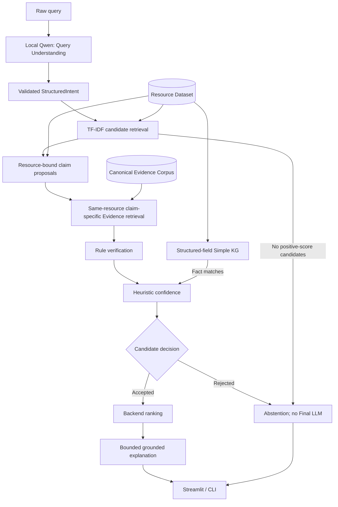

# Summer Edition architecture

VeriTrust-Rec makes AI/ML resource recommendations inspectable through
**Evidence -> Verification -> Confidence -> Decision**. This is an implemented
prototype, not the complete research system or a correctness guarantee.

## Data foundation

| Product | Responsibility | Implementation |
|---|---|---|
| Resource Dataset | Describes repositories and provides candidate-search text and structured facts | [Resource builder](../data_pipeline/resource_dataset/core.py) |
| Evidence Corpus | Supplies canonical README/metadata documents and chunks for checking claims | [Evidence builder](../data_pipeline/evidence/core.py) |

Preparation runs separately from recommendation:
`GitHub REST snapshots -> Resource build -> matching Evidence build -> validation
and human quality review`. Raw snapshots are not overwritten. Both builders
stage and validate outputs before publication, with manifests as commit markers;
this is not a cross-phase transaction. Missing sources are reported, not invented.

Resources use stable numeric identity `github:<repository-id>`; owner/name is
mutable. Semantic fields are not inferred from README prose. Logical Evidence
sources use `github:<repository-id>:readme` or `github:<repository-id>:metadata`;
document/chunk IDs identify particular content versions and positions.

Canonical README chunks remain exact contiguous normalized-document slices:

```python
document.text[chunk.source_start_char:chunk.source_end_char] == chunk.text
```

Headings remain section metadata rather than reconstructed text. Code/table
spans are atomic; overlap is boundary-aware. Identical text at different source
positions is retained. Runtime loading checks schemas, compatible versions,
build identities, counts and foreign keys; missing/incompatible data cause
explicit errors, not fallback to a hidden corpus. See [data setup](DATA_SETUP.md).

## Runtime dependencies



This shows dependencies, not literal call order. In
[run_core_pipeline](../recommender/pipeline.py), data validation and in-memory KG
construction precede candidate retrieval. The KG is not a semantic candidate
retriever. Each candidate then passes through claim proposal, Evidence retrieval,
verification, confidence and decision; only accepted candidates are finally ranked.

## Retrieval, KG and verification

Local Ollama/`qwen3:8b` converts a raw request into validated `StructuredIntent`.
A query-processing error means S1 was not run, not Evidence-based abstention.
Model validation is cached per client; query responses are not client state.
There is no cloud-model fallback.

[TF-IDF retrieval](../recommender/retrieval/retriever.py) uses canonical Resource
search text, cosine similarity and stable ID tie-breaking. Default Top-K is 5;
only positive-score candidates are returned, without random backfilling.
Human-language preference is excluded from the query builder, not matched to
repository programming language. Other parsed preferences are not guaranteed
to act as hard filters in this lexical prototype.

The [Simple KG](../recommender/kg/graph.py) uses provenance-backed structured
fields: topics -> `covers`, frameworks -> `uses`, language -> `written_in`, owner
-> `owned_by`. Empty frameworks create no `uses` facts. License stays a Resource
attribute. README keyword hits do not become KG facts.

[Claim proposals](../recommender/verification/claim_extractor.py) have stable IDs
and are bound to one candidate. Types are `uses_framework`, `covers_topic`,
`is_maintained`, and `has_license`. Metadata/intent may propose a claim; they do
not verify it. [Evidence retrieval](../recommender/retrieval/evidence.py) restricts
chunks to that Resource before lexical object/predicate/section scoring. It
returns default Top-3 positive-score chunks, prioritizing metadata for metadata
claims, and preserves real IDs, URLs, canonical text and source priors.

The [rule verifier](../recommender/verification/verifier.py) rejects cross-resource
Evidence. `SUPPORTED` means explicit support under the implemented rules;
`CONTRADICTED` means applicable explicit contrary Evidence; `UNKNOWN` means
neither sufficient support nor contradiction was established. Unknown is not false.

- Framework mention alone is insufficient; explicit use/dependency is required.
- Topic metadata can establish a normalized exact topic match.
- Maintenance checks the cited metadata chunk's `is_archived`/`pushed_at`, or
  explicit README maintenance statements.
- `has_license` means a recognized open-source license under the configured SPDX
  allow-list, not an exact-license claim. Different recognized licenses do not
  contradict each other; missing/unrecognized metadata is normally unknown.

Metadata decisions cite the actual metadata Evidence used, not an uncited
Resource field or unrelated README. Narrow rules can miss support or misread
context; their labels are not universal factual truth.

## Confidence, abstention and ranking

| Component | Definition | Default weight |
|---|---|---:|
| Retrieval | Candidate TF-IDF/cosine score | 0.20 |
| Evidence coverage | Claims with retrieved Evidence / all claims | 0.30 |
| Verification | `SUPPORTED` claims / all claims, including unknowns | 0.35 |
| KG support | Topic/framework claims matched by KG facts; 0.5 if none apply | 0.10 |
| Source prior | Mean across unique verification-used `(evidence_id, source_id)` pairs; 0 if none | 0.05 |

Multiple chunks from one verification-used source do not repeatedly weight its
prior; retrieved-but-unused chunks do not contribute. The weighted confidence is
not a calibrated probability. `heuristic_v0` source priors are not trustworthiness,
Evidence Strength or quality scores. Defaults live in [summer.yaml](../configs/summer.yaml).

A candidate abstains for a candidate-local critical error, an applicable verified
contradiction, zero Evidence coverage, or confidence below the default 0.50.
Accepted candidates are sorted by `0.60 * retrieval_score + 0.40 * confidence`,
then Resource ID. No candidates yields `NO_CANDIDATE`; rejecting all candidates
yields `ALL_CANDIDATES_ABSTAINED`. Query errors, global pipeline errors and normal
recommendation abstention remain distinct. Logging failure is only a warning.

## Grounded generation and UI

After core success, a backend GroundedResultPack supplies a bounded generation
view. Defaults allow 8 claims per Resource, 2 excerpts per claim, 280-character
claim text, 320-character excerpts and a 7,500-character serialized-view limit.
These are input/display budgets, not token guarantees; canonical Evidence and
its IDs are unchanged.

The Final LLM returns only `summary` and a `reason` keyed by each accepted
Resource ID. It cannot set facts, Claim/Evidence IDs, labels, ranks, scores or
confidence disclaimers. The backend validates the Resource set and hydrates
facts/references in backend rank order. Invalid/unavailable generation normally
uses a deterministic template with the real failure cause recorded. Unexpected
generation errors also do not rewrite core decisions. Abstained/error requests
do not invoke the Final LLM.

Identity/structure checks do not semantically verify every summary/reason
sentence. Model-generated prose can still be misleading.

[streamlit_app.py](../streamlit_app.py) is the root entrypoint; [app/](../app/)
renders Query, Recommendations, Evidence & Verification, and Pipeline Trace.
Ordinary reruns reuse results; Clear resets query/results. Top-K is copied per
request rather than mutating cached configuration.

## Implemented scope and future research

Implemented: GitHub data preparation, lexical retrieval, structured-field KG,
rule verification, heuristic confidence/abstention, local query parsing,
grounded explanations and bilingual UI. See [evaluation reports](README.md#evaluation-and-limitations)
and [reproducibility](REPRODUCIBILITY.md) for small-scale evidence and limitations.

Not implemented: embedding/vector/hybrid retrieval, general RAG infrastructure,
learned/NLI verification, research-grade Evidence Fusion, calibrated uncertainty,
multi-annotator research-scale evaluation or educational-fit guarantees.
These remain future directions, not present capabilities.
